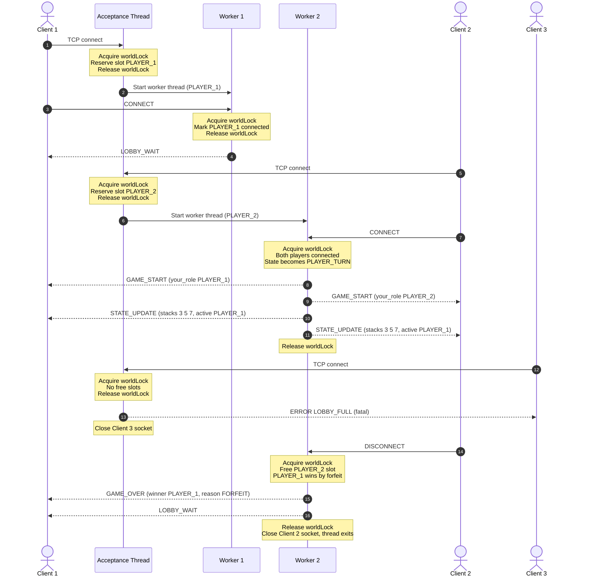
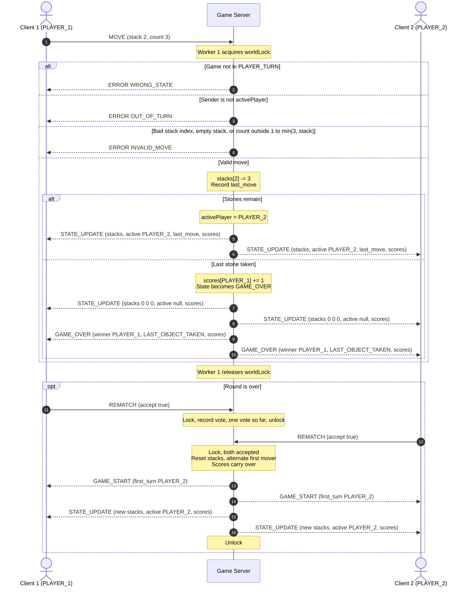

# Description
The Game of Nim uses multi-threading to handle concurrency. A dedicated worker thread is spawned for each client connected. 

The board state of the game is shared by both player threads. To prevent race conditions, only one client may modify the board at a time. e.g. when Client A is taking its turn, Client B's attempts at editing the board will be denied (see fsm_specification.md), but Client B's thread still acquires the lock before checking whose turn it is, because the turn check itself reads shared state (see Race Conditions Prevented). Threading is chosen purely on the basis that I am more familiar with it as a hobbyist game programmer.

On top of the two player threads, there is an acceptance thread; any third connection will be returned LOBBY_FULL and will be closed immediately. This keeps both players from blocking the server by ensuring only the maximum amount of players is allowed to connect, and the server does not hopelessly attempt to keep putting a third player in.

# Connection Lifecycle
See fsm_specification.md for more details on the lifecycle of the game. In particular, as relates to the threading model:

1. Listening (INIT to WAITING_FOR_PLAYERS): The main thread creates the listening socket, binds it, calls listen(), and that becomes the acceptance thread. It loops on accept() and never reads from a client socket, so a slow or stupid client not sending connections isn't going to stall the server.

2. Accept and slot reservation: When accept() returns a new socket, the acceptance thread acquires worldLock and checks the player slots. If both slots are taken, it sends the fatal ERROR LOBBY_FULL, closes the socket, and goes back to accept(). Otherwise it reserves the first free slot (PLAYER_1, then PLAYER_2) for that socket, releases the lock, and starts a worker thread.

3. Registration/client connection: The worker thread reads the first message. Anything other than CONNECT will fail and close with fatal error WRONG_STATE. On CONNECT it acquires worldLock and marks its slot as connected. If it is the only connected player, it sends LOBBY_WAIT. If both players are now connected, it moves the game to GAME_START, sends GAME_START (with each client's own your_role) to both players, sends the first STATE_UPDATE to both, and moves the game to PLAYER_TURN.

4. Each worker thread loops on recv() with a socket timeout. Bytes are appended to the thread's private receive buffer and split on \n, so each complete line is one JSON message. Every message is decoded and dispatched (MOVE, REMATCH, DISCONNECT). The handlers that touch shared state run inside worldLock as described under Critical Sections. Because each client has its own thread blocked in its own recv(), one player waiting or thinking never blocks the other player's thread or the acceptance thread.
5. Teardown: The receive loop ends when any of the following happen:
   - the client sends DISCONNECT
   - recv() returns b"" (EOF)
   - ConnectionResetError, BrokenPipeError, ConnectionAbortedError, or TimeoutError is raised
   - the server sends a fatal ERROR, such as MESSAGE_TOO_BIG when a line exceeds 4096 bytes

   In every case the worker runs the same cleanup. It acquires worldLock, frees its slot, and removes its socket from the client list. If a round was in progress, it records the remaining player as the winner and sends that player GAME_OVER with reason FORFEIT and rematchAvailable false. The game then goes through CLEANUP back to WAITING_FOR_PLAYERS, and the remaining player is moved back to the lobby as PLAYER_1 and sent LOBBY_WAIT. After releasing the lock, the worker calls shutdown() and close() on its socket and the thread returns.

Capacity: The server runs at most three threads at a time: the acceptance thread and two worker threads. Additional connections are rejected by the acceptance thread without ever spawning a worker, so the number of threads is fixed no matter how many clients try to connect. This hopefully prevents connecting clients from effectively DoSing the server.

# Shared Variables
The following variables are shared between both players:
- Each "stack" of rocks (both player threads read and write) 
- The currently active player, activePlayer (read by both player threads, written by the player thread whose legal move ends the turn)
- The game state, read and written by everything on every state transition
- Client sockets (read and written by server)
- Scores (number of games won between players)
- Player slots
- Rematch votes
- Who moves first between rounds

# Locks
For simplicity's sake, there will be one lock (worldLock = threading.Lock()) that guards all the shared variables listed above. This will prevent any deadlocks from happening and keep multithreading nightmares from occurring. I personally appreciate that this is not really using the full power of multithreading but if you've ever tried to write a multithreaded app in C/C++ you know how much of a horrific travesty it can be trying to get processes to play nice.

The lock should release if a handler ever raises an exception (i.e BrokenPipeError) so a crashed or corrupt handler shouldn't leave the other thread in deadlock forever.

There will be a routine validateMove() that will return: 
- ERROR WRONG_STATE if the game is not in PLAYER_TURN 
- ERROR OUT_OF_TURN if role is not activePlayer 
- ERROR INVALID_MOVE if the stack index is OOB, the stack is empty, or count is not between 1 and min(3, stones in that stack). These errors should be non-fatal although they're probably grounds for suspicion of cheating, but they shouldn't impact the shared state of the board.

# Critical Sections
Every state mentioned here happens between acquiring and releasing worldLock:
- MOVE: Checks the state of the game, checks whose turn it is, validates that the move is legal (i.e player whose turn it isn't shouldn't be able to modify the game), changes the selected stack to whatever the player specifies according to fsm_specification, checks if the move resulted in a win, then switches turns.
- SCORE: If the move took the last stone, the mover's score is incremented and GAME_OVER is broadcast before the lock is released, so no other message can be handled between the winning move and the score update.
- CONNECT: Assigns a player slot if the server is not already full.
- REMATCH: If both players have voted for a rematch, the board is reset.
- DISCONNECT: If any player disconnects at any time, the round ends, and the remaining player (if any) is told that the other player forfeited.

# Race Conditions
The main race is two moves being processed for the same turn. Suppose PLAYER_1 sends a MOVE and, at nearly the same moment, PLAYER_2 sends a MOVE (or PLAYER_1 sends a second MOVE). Without a lock, both worker threads could read activePlayer as PLAYER_1, both could pass the turn check, and both could subtract from the stacks before either one switched the turn. The board could then contain two moves for a single turn or otherwise have some insane invalid board state (negative stack size, etc.) 

Putting every check inside a singular critical section masively lowers the chance for a race condition to happen by making it atomic. Basically, whichever thread acquires worldLock first completes the whole move and switches activePlayer before releasing it. The second thread then sees the updated activePlayer and stacks and is rejected with OUT_OF_TURN or INVALID_MOVE.

The same reasoning covers the other shared variables:
- Player slots: two clients accepted back to back could both see a free PLAYER_2 slot. Reserving slots under the lock prevents this.
- Rematch votes: both players could vote at the same moment, and each thread could see only its own vote and never start the new round. Recording the vote and checking for two accepts in one critical section means exactly one thread sees both votes and starts the round.
- Disconnect during a move: a player could disconnect while the other player's move is being processed. Because teardown also takes the lock, it waits until the move and its broadcast finish, and then sends the forfeit.

# Broadcast Flow
Broadcasts are sent while holding worldLock. broadcast() calls sendall() on PLAYER_1's socket and then on PLAYER_2's socket before the critical section ends.

This was chosen over copying the state and sending after releasing the lock. With copy-then-send, thread A could finish move 1 and release the lock, thread B could finish move 2 and send its update, and only then would thread A send move 1's update, so clients could see updates out of order. Sending inside the lock means each update is fully written to both sockets before the next state change can happen. Both clients therefore receive every STATE_UPDATE and GAME_OVER, in the same order, built from the same state.

The cost is that a send to a stalled client could hold the lock. Messages are a few hundred bytes, far smaller than the TCP send buffer, so sendall() normally returns immediately. Each socket also has a timeout, so a stalled send raises TimeoutError instead of blocking forever. If a send fails during a broadcast, the exception propagates out of the with block (releasing the lock), ends that player's receive loop, and that player is handled as a forfeit by the normal teardown path.

# Private Thread Stuff
The following state is owned by worker threads privately:
- Its receive buffer of bytes read from recv() that have not yet formed a complete line
- Its reads from its own socket. Only that client's worker thread ever calls recv() on it.
- Its role/player ID (PLAYER_1 or PLAYER_2), which is fixed when the thread is started
- Messages it is decoding and validating before taking the lock

Only sends will be shared so players can write game state to each other's sockets. Every send happens inside worldLock, so two threads never write to the same socket at the same time and messages on the wire are never interleaved.

# Score and Leaderboard Synchronization
Scores are stored in server memory as a single dictionary, scores = {"PLAYER_1": int, "PLAYER_2": int}, counting rounds won in the current match. It is one of the shared variables guarded by worldLock, and it is only modified inside a critical section:
- When a legal MOVE takes the last stone, the mover's score is incremented in the same critical section as the move.
- On a forfeit, the remaining player is reported as the winner in GAME_OVER.
- When both players accept a REMATCH, the stacks are reset (or randomized with --random), the first mover alternates, and scores carry over.
- When a match ends (a REMATCH decline or a disconnect), scores are reset to zero during CLEANUP so the next pair of players starts fresh.

Clients never keep their own score. Every STATE_UPDATE and every GAME_OVER includes the full scores object, so the leaderboard on each client is always the server's copy. When a round ends, the server broadcasts STATE_UPDATE (final board, active_player null) and then GAME_OVER (winner, reason, scores, rematch_available) to both clients inside the same critical section as the score increment, so both clients receive the updated scores before any other message is processed.

# Sequence Diagrams

# Connection Lifecycle

# Move Validation, Turn Enforcement, and Score Broadcast

